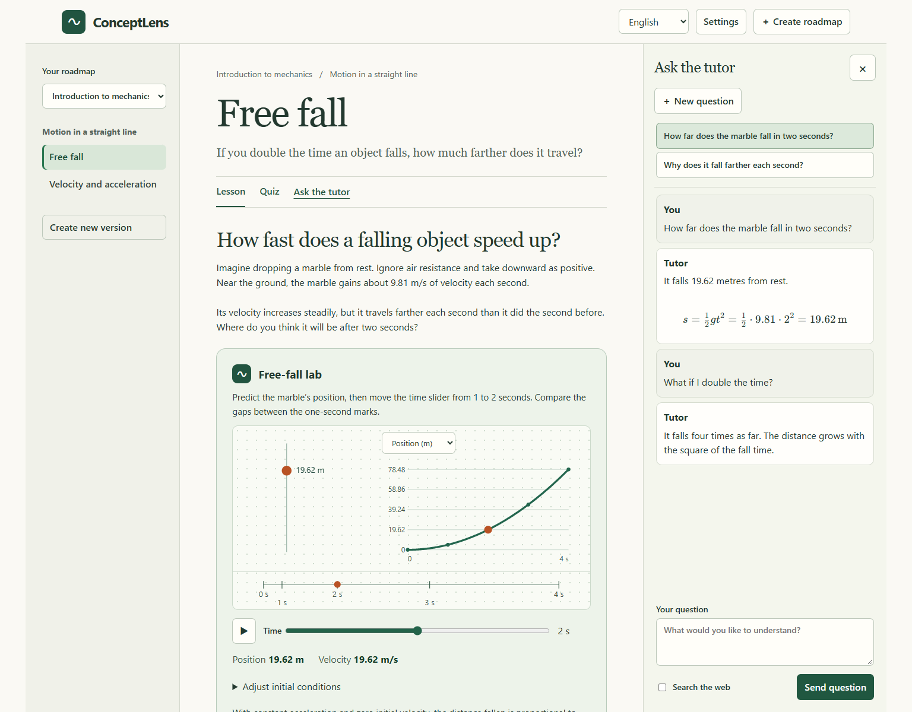

# ConceptLens

ConceptLens is a local-first AI study app for one learner on Windows. Turn a topic and a learning goal into a course roadmap, open lessons as you progress, and ask a tutor about a specific passage or simulation. The reader and its built-in physics lessons are available in English and Vietnamese.

## Quick start

Install Python 3.12 with the Windows `py` launcher and Node.js 22.12 or later with npm. Run this from the project directory.

~~~powershell
.\start.cmd
~~~

The first launch installs dependencies and builds the reader. Open [ConceptLens](http://127.0.0.1:8765/) in your browser. Keep the terminal open while studying and press `Ctrl+C` to stop the server.

Try **Free fall** before setting up an AI provider. Set the simulation to **2 s** with the default initial conditions. The distance is **19.62 m**, and the quiz accepts the equivalent answer `1962 cm`.

## What you can do

- **Plan a course.** Set your topic, level, goal and available study time. Review a generated roadmap before saving it, and create a new version as your goals change.
- **Study one lesson at a time.** Choose **Start lesson** on a new topic to generate its lesson, quiz and illustration briefs. The reader supports LaTeX, interactive illustrations and physics simulations. It saves your reading position, simulation state and quiz attempts.
- **Keep studying when a scene fails.** Lesson text and the quiz are saved before illustration generation. Use **Retry illustration** to create the affected scene from its saved brief, including after reopening the lesson. Existing illustrations can also be repaired from the reader.
- **Ask about the material.** Use the lesson-wide tutor or highlight a passage to open a separate conversation. A highlight in a simulation explanation can carry the values displayed when you selected it. The tutor can use a local calculator and constant-acceleration simulation. OpenAI and Codex CLI also support **Search the web** with source links.
- **Manage learner memory.** Opt in through **Settings → Learner memory** to save goals and preferences and track recurring unit mistakes from graded attempts. You can inspect supporting quiz answers, pause capture, edit entries or forget them.

Saved lessons, simulations and quiz grading run locally. Creating roadmaps or lessons, generating or repairing illustrations, and asking the tutor require a configured AI provider.

## AI provider setup

In **Settings**, choose an **AI provider** for roadmaps, lesson text and tutor replies. **Illustration provider** defaults to the lesson provider. You can set a separate provider and model for illustration generation and repair. For Codex and Antigravity, the illustration picker loads names and model IDs from the installed CLI. Search by either field or use **Refresh illustration models** to reload the catalog.

| Provider | Setup |
| --- | --- |
| OpenAI API | Save a key in Settings or set `OPENAI_API_KEY` before launch. Set `OPENAI_MODEL` to override the app's default model. |
| Codex CLI | Install `codex` on `PATH`. Run `codex login` and check `codex login status` under the Windows account that starts ConceptLens. |
| Google Gemini API | Save a key in Settings or set `GEMINI_API_KEY` or `GOOGLE_API_KEY` before launch. Reopen Settings and use **Load Gemini models** to see available Gemini models. |
| Google Antigravity CLI | Install `agy` on `PATH` and run it in a terminal to sign in. Choose the illustration model from the CLI catalog. The general agy model field also accepts a model ID from `agy models`. |

## Optional tutor features

| Feature | Availability |
| --- | --- |
| Bounded conversation context | Set `STUDY_BOUNDED_CONTEXT=1` before launch to limit the input sent to the model and summarize older turns. The full transcript stays in the reader. [Architecture](documents/phase-1-architecture.md) |
| Shared tutor orchestration | Set `STUDY_TUTOR_AGENT=1` before launch to enable the opt-in routing loop with tool and time limits. [Architecture](documents/phase-4-architecture.md) |
| Memory retrieval in tutor replies | Requires bounded context, learner memory enabled and a qualified local encoder configured through `STUDY_EMBEDDING_MODEL_DIR`. The standard installation uses lesson and conversation context because the benchmark has yet to qualify an encoder. Local memory controls work independently. [Retrieval benchmark](result/phase-3/benchmark.md) |

When retrieval is ready, a tutor request can include relevant learner memory statements and their source details. **Memories used** in the reply opens the associated memory and any supporting quiz evidence.

## Study data and backups

The server listens on `127.0.0.1`. Roadmaps are stored in `data/<roadmap-id>/roadmap.json`. Lessons, progress, highlights, tutor conversations, provider settings and learner memory are stored in `data/study.sqlite`. AI requests send the context needed for the task to the selected provider. Windows protects API keys saved in Settings with DPAPI under the account that saved them.

To back up or restore your study history, stop the server and copy the entire `data` directory. Set `STUDY_DATA` before launch to use a different directory.

## Development and verification

The reader uses React, TypeScript, Vite and KaTeX. The Python backend uses FastAPI and SQLite, with Pint for unit-aware grading. Generated illustrations render in a sandboxed iframe. [Lesson prompt](prompts/lessons/generate.md) · [Illustration contract](prompts/illustrations/contract.md) · [Tutor instructions](prompts/tutor/instructions.md)

~~~powershell
npm.cmd run build
.\.venv\Scripts\python.exe -m unittest discover -s tests
npm.cmd run test:ui
~~~

The browser suite needs Chrome or Chromium and access to a local TCP port. Set `CHROME_PATH` for a custom installation. The scripted tutor replay and phase reports include commands and fixtures for reproducing the checks. [Tutor replay](tests/evals/runner.py) · [Tutor verification](result/phase-4/document.md) · [Illustration verification](result/phase-4c/document.md)

Automated checks cover model selection, partial lessons, scene retries and repair with scripted provider responses. Live end-to-end verification of the Codex-to-Antigravity illustration flow remains open. [Verification report](result/phase-4c/document.md)
