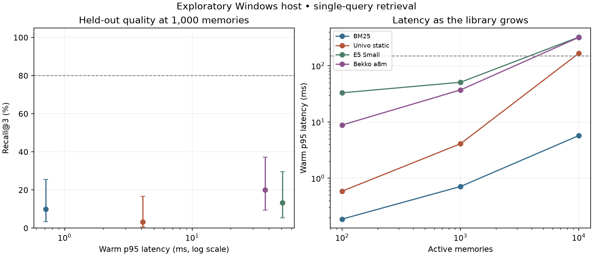

# CPU-first bilingual learner-memory retrieval

## Abstract

We evaluated four retrieval configurations for short English and Vietnamese learner memories. The experiment paired scripted questions across configurations and measured batch-one retrieval on Windows. At 1,000 memories, Bekko ranked the correct item in the top three for 24 of 30 held-out questions before applying the cutoff and returned it for 6 of 30 after applying the frozen cutoff. All four configurations abstained on the 30 unsupported held-out questions at that scale. No encoder qualified. This is an exploratory host study. Qualification additionally requires measurements on a two-core, 4 GiB Windows machine through the integrated application.

## Research question

Which local encoder improves on a lexical baseline for English–Vietnamese retrieval while meeting a small machine's resource budget? The comparisons separate recall and abstention from latency, installed footprint and working set. The scientific aim is to locate failure modes, including candidates that place the correct item in the top three but assign similarly high scores to an unsupported query.

## Published and project-supplied evidence

Bekko reports MMTEB Retrieval nDCG@10 of 56.2 versus 50.9 for multilingual E5 Small. In the same preprint, OpenVINO processed 33 versus 19 documents per second on Raspberry Pi 5 with a batch of 64. Those results inform the shortlist and use different workloads and metrics from the measurements below. [Bekko preprint, sections 5.1 and 7.2](https://arxiv.org/html/2607.25180)

The Bekko package tested here quantizes the token table in the OpenVINO IR. E5 used Xenova's ONNX quantized export and the E5 model card's query and passage prefixes. Univo used the derivative 128-dimensional static INT8 artifact. The Univo model averages token vectors and is inherently insensitive to word order. SQLite FTS5 with BM25 provided a lexical baseline. [Bekko IR](https://huggingface.co/hotchpotch/bekko-embedding-v1-a8m/tree/main/openvino) · [E5 model card](https://huggingface.co/intfloat/multilingual-e5-small) · [Xenova ONNX files](https://huggingface.co/Xenova/multilingual-e5-small/tree/main/onnx) · [Univo model card](https://huggingface.co/univo-models/static-similarity-mrl-multilingual-int8-128) · [SQLite FTS5](https://www.sqlite.org/fts5.html)

## Methods

- **Dataset.** Dev and held-out each have 30 answerable and 30 abstention queries on different saved statements and topics. Positive queries are balanced across EN→VI, VI→EN, EN→EN, VI→VI and unaccented VI→EN. Unsupported queries include related topics, missing personal facts and six queries per split with an exact-text inactive record. Filler memories expand the active library to 100, 1,000 and 10,000 rows. The fixtures use the raw question as the common input so that alternate utterances remain comparable across engines. The same synthetic filler templates are reused at each size and across splits. [Fixtures](code/benchmark_fixtures.py)
- **Retrieval.** The runner uses local CPU inference, a maximum of 128 tokens, normalized vectors and an exact SQLite-fed cosine scan using float32 rows and math.sumprod. Only active rows are eligible. BM25 receives the same eligible records and query text. It uses OR over de-duplicated Unicode tokens with Latin diacritics removed by FTS5. No learner data or AI provider is involved. [Runner](code/benchmark_run.py) · [Shared encoder](../../backend/embedding_cpu.py)
- **Calibration.** The cutoff is the next representable float above the highest dev abstention score at 1,000 memories. This is the lowest cutoff that rejects all observed dev negatives and preserves the most hits under that constraint. The frozen cutoff is applied unchanged to held-out and the other library sizes. Each quality estimate uses 30 independent fixture IDs and the first seeded pass. Repeats measure timing and are excluded from the quality denominator. A result observed after 200 ms is counted as an abstention in the quality analysis. Intervals are 95% Wilson intervals over answerable or abstention fixture IDs.
- **Timing and resources.** Three batch-one warm passes use seeded permutations, 180 requests per model, split and library size. For each split there are three fresh subprocess loads and first queries. The OS file cache was left intact. Latency starts before query encoding or tokenization and ends after SQLite ranking returns top three. The runner records its peak Windows working set across the full scale sweep relative to its initial working set. Disk usage includes provisioned weights, tokenizer and the unpacked dependency tree. It excludes the application, its existing Python runtime, and the SQLite index, which is recorded separately. Native inference is capped at two threads. BM25 runs in the single caller thread. [Measurement code](code/benchmark_run.py) · [Analysis code](code/benchmark_analyze.py)
- **Host.** Windows 11 build 26200, Intel Core i5-12450H, 12 logical CPUs and 16 GiB installed RAM. Python 3.12.14 and SQLite 3.53.1. The benchmark uses one process for inference and SQLite scanning and omits application IPC, source validation and the application-plus-worker RAM measurement. Exact runtime versions, commands, artifact hashes, source revision and code hashes appear in the raw per-run evidence.

## Release criteria

At 1,000 memories, an encoder must reach recall@3 ≥80%, rank the canonical VI→EN preference first and abstain on every unsupported fixture. Warm p95 must be ≤150 ms on the target platform, added combined app and worker peak RAM ≤350 MiB and installed optional footprint ≤250 MiB. Among dev configurations that pass, the higher recall wins, with a two-percentage-point tie band resolved by lower RAM then lower p95. The chosen artifact and cutoff must independently pass on held-out and on the target machine.

## Development results

All four configurations abstained on 30/30 unsupported dev queries at their fitted cutoffs. Bekko returned the most correct results after calibration, 6/30. E5 and Bekko both exceeded the optional package budget with the installed distributions tested. The working-set figures below are single-process observations across the complete size sweep.

| Configuration | Recall@3 before cutoff | Recall@3 after cutoff (95% CI) | Top 1 | Warm p50 / p95 at 1,000 (ms) | Fresh load + first query median (ms) | Peak increase (MiB) | Optional package (MiB) |
|---|---:|---:|---:|---:|---:|---:|---:|
| BM25 | 7/30 | 2/30 (1.8–21.3%) | 2/30 | 0.58 / 0.91 | 0.5 | 9.2 | 0.0 |
| Univo static | 10/30 | 1/30 (0.6–16.7%) | 1/30 | 12.78 / 25.86 | 299.4 | 49.2 | 102.0 |
| E5 Small INT8 | 15/30 | 4/30 (5.3–29.7%) | 4/30 | 13.64 / 16.87 | 2,171.2 | 496.2 | 270.9 |
| Bekko a8m INT8 | 18/30 | 6/30 (9.5–37.3%) | 6/30 | 11.76 / 14.26 | 1,442.7 | 381.9 | 489.1 |

The dev false-positive rate was 0/30 with a 95% Wilson interval of **0–11.4%** for each configuration. Since the cutoffs were fitted on these queries, that interval is descriptive and does not estimate post-selection generalization. The dev result selected no encoder. Raw dev files and their SHA-256 values were frozen before measuring held-out. [Frozen cutoffs and input hashes](evidence/benchmark-frozen.json) · [BM25 dev](evidence/benchmark-bm25-dev.json.gz) · [Univo dev](evidence/benchmark-static-dev.json.gz) · [E5 dev](evidence/benchmark-e5-dev.json.gz) · [Bekko dev](evidence/benchmark-bekko-dev.json.gz)

## Held-out results

We applied the frozen dev cutoffs to all four configurations. The table uses the 1,000-memory library and 30 answerable queries. The top candidate was correct for every retrieved hit. All four configurations missed the canonical VI→EN question and returned zero matches for the 30 unsupported queries (95% Wilson interval of 0–11.4% for the false-positive rate). No configuration exceeded the 200 ms request budget in the 180 per-query timings at this scale. [Per-query outcomes](evidence/benchmark-outcomes.json) · [Complete metrics](evidence/benchmark-summary.csv)

| Configuration | Raw recall@3 | Recall@3 with frozen cutoff (95% CI) | Warm p50 / p95 (ms) | Fresh load + first query median (ms) | Peak increase over sweep (MiB) |
|---|---:|---:|---:|---:|---:|
| BM25 | 10/30 | 3/30 (3.5–25.6%) | 0.50 / 0.71 | 0.5 | 9.3 |
| Univo static | 12/30 | 1/30 (0.6–16.7%) | 3.11 / 4.10 | 218.6 | 48.7 |
| E5 Small INT8 | 16/30 | 4/30 (5.3–29.7%) | 36.06 / 50.94 | 1,717.3 | 496.4 |
| Bekko a8m INT8 | 24/30 | 6/30 (9.5–37.3%) | 21.14 / 37.21 | 1,495.6 | 382.0 |

At 10,000 held-out memories, the p95 was 5.73 ms for BM25, 167.31 ms for Univo, 324.27 ms for E5 and 320.68 ms for Bekko. Of 180 requests per configuration, 0, 5, 149 and 100 respectively exceeded the 200 ms deadline. These measurements describe the exploratory runner and illustrate how SQLite scan cost grows with the active library. [BM25 held-out](evidence/benchmark-bm25-heldout.json.gz) · [Univo held-out](evidence/benchmark-static-heldout.json.gz) · [E5 held-out](evidence/benchmark-e5-heldout.json.gz) · [Bekko held-out](evidence/benchmark-bekko-heldout.json.gz)

Figure 1. The dashed lines mark the 80% recall and 150 ms p95 release targets. The latter applies at 1,000 memories. Each held-out size contains 180 timed requests per configuration.

## Error analysis

- **Relevant item ranked but rejected.** For the Vietnamese question about what visual should come before a map-projection formula, Bekko ranked the correct English preference second. Its cosine score was 0.396, below the frozen cutoff of 0.502. In the fabric swatch example, Bekko ranked the English preference first with cosine 0.478, and the threshold still rejected it.
- **Incorrect candidates outranked the answer.** For the unaccented Vietnamese question about drawing an orbit to explain tides, E5 ranked the correct item second at 0.839, just below a synthetic filler and below its cutoff of 0.869. The other three configurations did not place the correct memory in their raw top three on this query.
- **Limited cross-language recovery at the agreed operating point.** Bekko's six held-out hits were three VI→VI, two EN→EN and one EN→VI. E5, Univo and BM25 recovered same-language Vietnamese cases only. These counts use the fixture direction labels and run-level decisions at 1,000 memories. [Per-query outcomes](evidence/benchmark-outcomes.json) · [Frozen cutoffs](evidence/benchmark-frozen.json)

## Limitations and conclusion

The queries and repeated filler templates are synthetic. The comparison does not estimate real-world abstention frequency or learning outcomes. The confidence intervals describe 30 labeled fixtures per group. They do not establish a zero production false-positive rate. The runner uses the raw question and omits production topic and highlight composition, process IPC, and live evidence checks. CPU affinity and background load were not controlled. Warm p95 varied between splits, including 14.26 to 37.21 ms for Bekko and 25.86 to 4.10 ms for Univo. These measurements are useful for describing the observed runs and cannot qualify a low-spec Windows device.

The experiment recorded 4,320 warm requests across two splits, three library sizes and four configurations. Bekko led the measured configurations on recall and exceeded the installed package budget with the tested distribution. Univo stayed below the resource thresholds in this component benchmark, with one held-out recall hit at 1,000 memories. No dev configuration reached the required recall at the calibrated abstention setting, so no artifact was nominated or approved. End-to-end latency and combined app and worker RAM remain unmeasured on the specified 4 GiB machine. The isolated Windows smoke check demonstrates loading and checksum rejection using synthetic data, without making a hardware qualification claim. [Measurement table](evidence/benchmark-summary.csv) · [Encoder smoke evidence](evidence/encoder-process-static.json) · [Smoke code](code/encoder_process_smoke.py)

## Reproduction

Start in the repository root, using the project's Python environment. Provision artifacts and runtime dependencies into a fresh ignored directory. The installed package versions below match the top-level versions in the raw evidence. The recorded per-run package lists identify every transitive version.

~~~powershell
$python = '.\.venv\Scripts\python.exe'
$scratch = '.test-data-phase3'
$code = 'result/phase-3/code'
$evidence = 'result/phase-3/evidence'
& $python -m pip install --only-binary :all: --target "$scratch/runtime-bekko" openvino==2026.4.1 numpy==2.5.5 tokenizers==0.23.3
& $python -m pip install --only-binary :all: --target "$scratch/runtime-e5" onnxruntime==1.32.0 numpy==2.5.5 tokenizers==0.23.3
& $python -m pip install --only-binary :all: --target "$scratch/runtime-static" numpy==2.5.5 tokenizers==0.23.3 safetensors==0.8.0
& $python -m pip install --only-binary :all: --target "$scratch/plot" matplotlib==3.11.2
& $python -B "$code/benchmark_download.py" "$scratch/models" bekko --revision c721113d59a1d91b447450324f51c4b3332c924a
& $python -B "$code/benchmark_download.py" "$scratch/models" e5 --revision 761b726dd34fb83930e26aab4e9ac3899aa1fa78
& $python -B "$code/benchmark_download.py" "$scratch/models" static --revision ee7c2cb71e6948246b2bf45ef47083d215d69f2a
$common = @('--models',"$scratch/models",'--runtimes',$scratch,'--scratch',"$scratch/index")
foreach ($kind in @('bm25','static','e5','bekko')) {
  & $python -B "$code/benchmark_run.py" $kind --split dev @common --output "$evidence/benchmark-$kind-dev.json.gz"
}
& $python -B "$code/benchmark_analyze.py" freeze $evidence
foreach ($kind in @('bm25','static','e5','bekko')) {
  & $python -B "$code/benchmark_run.py" $kind --split heldout @common --output "$evidence/benchmark-$kind-heldout.json.gz"
}
& $python -B "$code/benchmark_analyze.py" summarize $evidence --plot-runtime "$scratch/plot"
~~~

The downloader writes synthetic benchmark manifests with qualified set to false. A successfully recorded measurement or checksum does not activate an encoder in the application. [Download code](code/benchmark_download.py)
